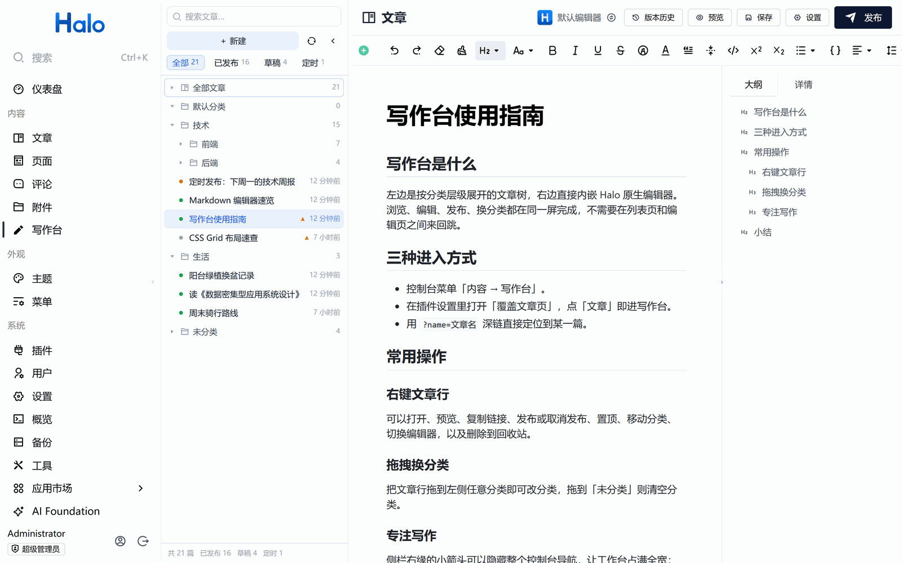
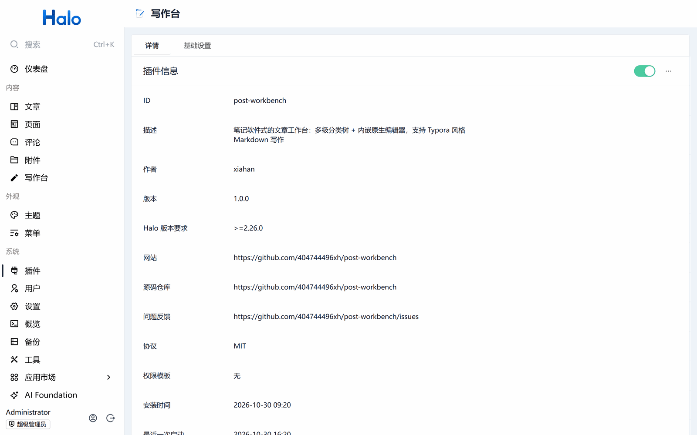
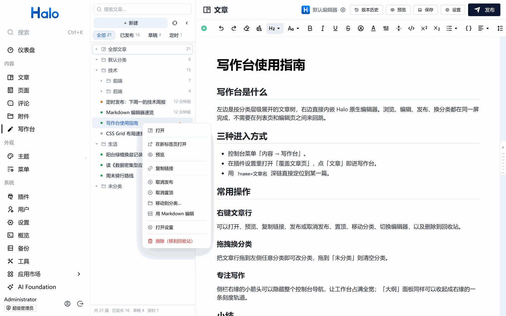
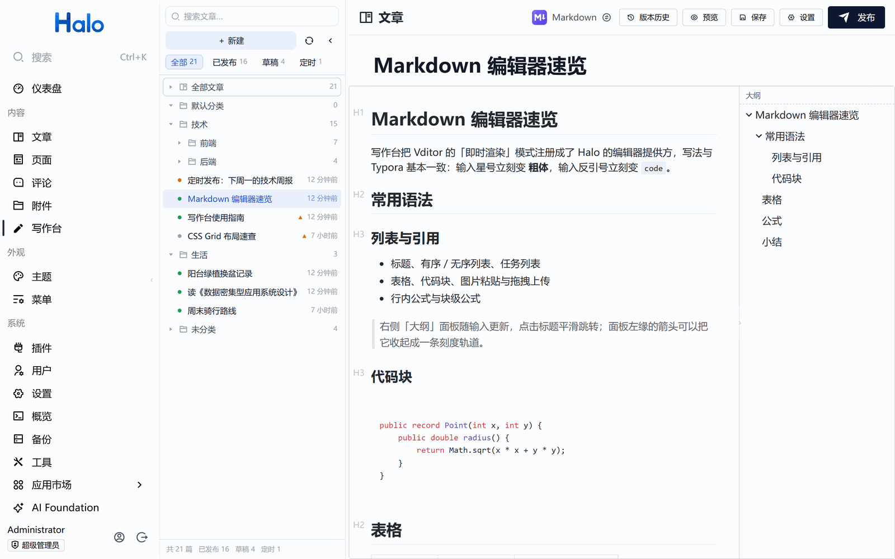
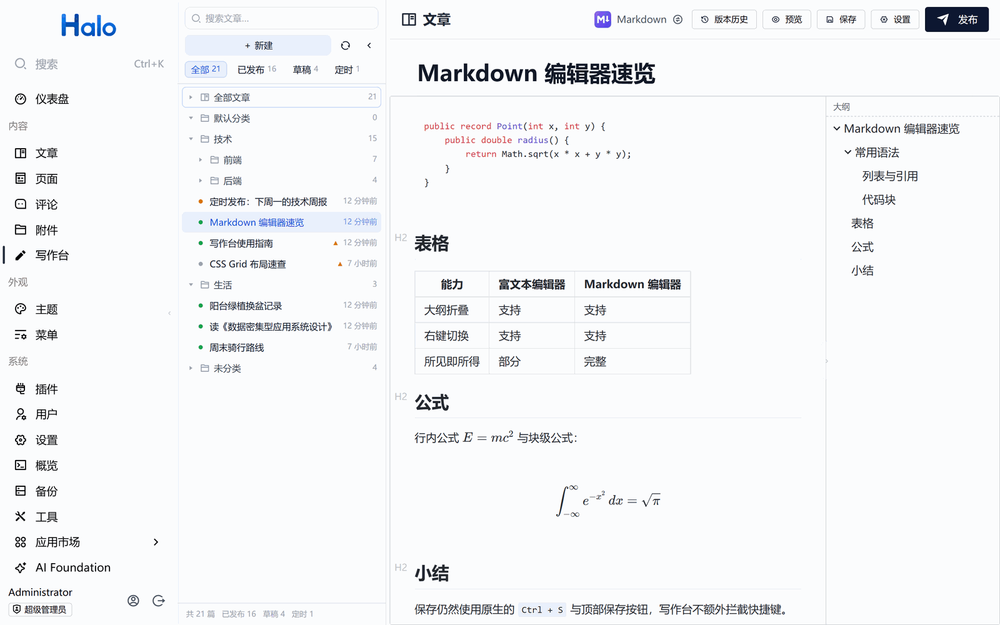
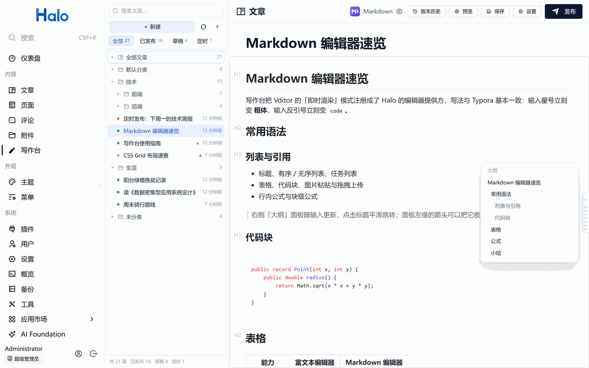
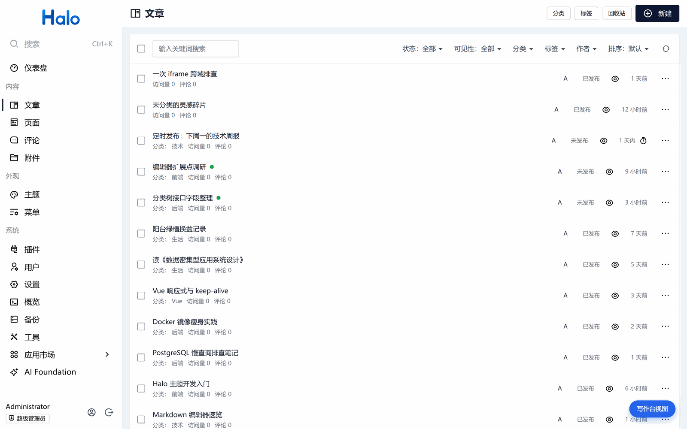

<p align="center">
  
</p>

# 写作台 (post-workbench)

Halo 2.26 控制台插件。把文章管理变成笔记软件式的工作台：左侧多级分类树，右侧内嵌原生编辑器，浏览、编辑、发布、换分类都在同一屏完成，不必在列表页和编辑页之间来回跳。同时提供一个 Typora 风格的 Markdown 编辑器，可按文章在富文本 / Markdown 之间切换。



| | |
| --- | --- |
| 适用版本 | Halo `>= 2.26.0`（在 2.26.x 控制台实测） |
| 界面语言 | 目前仅中文 |
| 权限 | 不申请额外权限模板，只用当前账号已有的文章读写权限 |
| 制品 | 单个 jar，约 1.4 MB，无外部依赖、不依赖第三方 CDN |
| 许可 | [MIT](LICENSE) |

- 下载：[Releases](https://github.com/404744496xh/post-workbench/releases)
- 反馈：[Issues](https://github.com/404744496xh/post-workbench/issues)

## 目录

- [快速开始](#快速开始)
- [功能](#功能)
- [插件设置](#插件设置)
- [数据与隐私](#数据与隐私)
- [卸载与残留清理](#卸载与残留清理)
- [已知限制](#已知限制)
- [第三方资源与许可](#第三方资源与许可)
- [构建](#构建)
- [技术说明](#技术说明)

## 快速开始

1. 下载 `post-workbench-<版本>.jar`。
2. Halo 控制台 → 插件 → 安装 → 上传 jar。
3. 安装后点「启用」。控制台左侧「内容」分组下会出现「写作台」。

入口与路由：

- 菜单：控制台 → 内容 → 写作台
- 地址：`/console/workbench`，支持深链 `/console/workbench?name=<文章名>` 直接定位到某一篇
- 快捷键搜索（`Ctrl+K`）可直接搜到「写作台」



## 功能

### 文章工作台



- **多级分类树**：按分类层级缩进展示，文章挂在所属分类下，未分类单独归组。支持搜索（标题 + 摘要，客户端即时过滤）、状态筛选（全部 / 已发布 / 草稿 / 定时）与数量统计；筛选时没有匹配文章的分类（含空的父级）自动隐藏。
- **内嵌原生编辑器**：右侧直接加载 Halo 原生文章编辑器（同源 iframe），隐藏原生侧栏与页脚。标题、正文、保存、发布、版本历史、预览、文章设置、AI 等全部是原生逻辑，Halo 升级后自动获得新能力。
- **右键菜单**：打开、新标签打开、预览、复制链接、发布 / 取消发布、置顶 / 取消置顶、移动分类、用 Markdown / 富文本编辑、文章设置、删除（进回收站）。
- **拖拽换分类**：把文章行拖到任意分类即可更换，拖到「未分类」则清空分类。
- **新建文章**：可指定分类创建，创建后自动补写分类并出现在树中。
- **悬停摘要**：行内只显示标题、状态点、相对时间与置顶标记，悬停约 0.3s 才弹出摘要卡片，避免列表噪音。
- **自动同步**：切换文章时静默刷新列表（改名即时反映）；页面可见时每 60s 轮询，窗口重新聚焦时再刷一次。

### Markdown 编辑器





- 注册为 Halo 编辑器提供方（`rawType: markdown`），原生编辑器页的「默认编辑器」下拉里也能选它。
- 基于 Vditor「即时渲染」（IR）模式，隐藏工具栏，正文居中 800px 栏宽、大标题输入框，写法与 Typora 基本一致：输入星号立刻变 **粗体**，输入反引号立刻变 `code`。
- 支持标题、列表、引用、表格、代码块高亮、图片粘贴 / 拖拽上传、行内与块级公式。
- 右侧「大纲」面板随输入更新，点击标题平滑跳转。
- 富文本 ⇄ Markdown 可按文章切换：右键菜单按当前格式显示「用 Markdown 编辑」或「切换到富文本编辑器」，确认后自动转换正文并写回 `content.halo.run/preferred-editor` 注解。富文本转 Markdown 保留标题、加粗、斜体、链接、列表、引用、代码块、表格、图片（含图注）与音视频 / iframe 原始标签；颜色、对齐、画廊排版等纯富文本样式会丢失。
- **打开即校正渲染结果**：Markdown 编辑器挂载后会用当前源码重新生成 HTML 并回写。历史上被格式转换插件留下「源码是 Markdown、前台却渲染旧 HTML」的文章，在 Markdown 编辑器里打开并保存一次即可恢复正常排版。
- 保存沿用原生 `Ctrl/⌘ + S` 与顶部保存按钮，写作台不额外拦截快捷键。

### 专注与布局



- **隐藏控制台导航**：控制台侧栏右缘垂直中部有一个低调的「‹」箭头，点击隐藏导航让工作台占满全宽；隐藏后工作台左缘出现「›」箭头恢复。偏好本地记忆，离开写作台自动恢复导航。
- **大纲折叠**：「大纲 / 详情」面板左缘中部箭头可收起面板让正文占满；收起后右缘保留一条细栏（标题刻度），悬停显示标题列表、点击平滑跳转。富文本与 Markdown 编辑器共用同一个折叠偏好。
- **树宽可调**：拖拽 220–560px，双击复位，本地记忆。
- **窄屏自适应**：窗口宽度小于 1000px 时自动收起分类树，通过左侧细栏一键展开。

### 与原生文章页共存



- 默认作为独立菜单与原生「文章」页并存，互不影响。
- 打开插件设置里的「覆盖文章页」后，访问「文章」即进入写作台；写作台头部出现「打开原文章视图」按钮，原生文章页右下角出现「写作台视图」悬浮按钮，可随时来回切换。
- 当前停在哪个视图会被记住，切去别的页面再回到「文章」仍是上次那个视图。

## 插件设置

控制台 → 插件 → 写作台 → 「基础设置」，目前只有一项：

| 设置项 | 默认 | 说明 |
| --- | --- | --- |
| 覆盖文章页 | 关闭 | 开启后访问原生「文章」页直接进入写作台，侧栏「写作台」独立入口隐藏；写作台头部与原生文章页各出现一个互相切换的按钮。关闭后两者都恢复原样。 |

## 数据与隐私

- **不向站外发起任何请求**。Markdown 运行时（lute 解析引擎、图标、中文语言包、KaTeX、highlight.js）全部随插件打包，`cdn` 指向插件自身的静态资源目录。
- **没有自定义后端**。插件的 Java 侧只有一个空的 `BasePlugin` 子类，不注册接口、不新增数据模型、不建表；所有读写都通过浏览器里已登录的 Halo 控制台原生接口完成，权限完全等同当前账号。
- **写入 Halo 的数据**只有两类：文章本身的内容（保存、发布、置顶、换分类、编辑器转换），以及记录某篇文章首选编辑器的注解 `content.halo.run/preferred-editor`。
- **浏览器本地存储**只有 4 个偏好键，不含正文内容，且仅对当前浏览器生效：
  - `post-workbench:tree-width`：分类树宽度
  - `post-workbench:console-hidden`：是否隐藏控制台导航
  - `post-workbench:outline-hidden`：是否折叠大纲面板
  - `post-workbench:native-posts`：「覆盖文章页」开关下当前停在哪个视图
- Halo 侧另有插件自身的 `post-workbench-settings`（设置）与 `post-workbench-config`（配置），由 Halo 插件机制自动创建与管理。

## 卸载与清理

控制台 → 插件 → 写作台 → 停用 → 卸载。Halo 会一并删除插件的 `post-workbench-settings` 与 `post-workbench-config`，不留服务端残留。

卸载后仍可能存在、但都不影响功能的痕迹：

1. 浏览器 `localStorage` 里的 4 个 `post-workbench:*` 键。需要清理时：在控制台页面按 F12 → Application → Local Storage，删除以 `post-workbench:` 开头的项。
2. 用「用 Markdown 编辑 / 切换到富文本编辑器」改过的文章，正文与 `content.halo.run/preferred-editor` 注解会保留转换结果。这是内容变更而非插件残留；想还原就在原生编辑器里换回原编辑器。
3. 若卸载前开着「覆盖文章页」，卸载后原生「文章」页与侧栏入口自动恢复。

## 已知限制

- 界面文案目前只有中文。
- 分类树一次最多加载最近 5000 篇文章（底部会显示「已加载最近 5000 篇」），更大的站点建议仍用原生文章页做批量管理。
- 内嵌编辑器依赖 Halo 控制台的 DOM 结构（隐藏侧栏 / 页脚的选择器），Halo 大版本升级后需要回归检查。
- 富文本转 Markdown 是有损转换，颜色、对齐、画廊等排版样式无法用 Markdown 表达。
- 定时发布、可见性、评论开关等文章属性仍在原生「文章设置」里改，写作台不重复实现。

## 第三方资源与许可

写作台自身以 MIT 发布。jar 内随包分发的第三方资源如下，均按其原始许可保留声明：

| 组件 | 版本 | 用途 | 许可 |
| --- | --- | --- | --- |
| [Vditor](https://github.com/Vanessa219/vditor) | 4.0.1 | Markdown 即时渲染编辑器（含 lute 解析引擎、中文语言包、图标） | MIT |
| [KaTeX](https://katex.org/) | 0.16.9（随 Vditor 打包） | 数学公式渲染 | 代码 MIT；字体 [SIL OFL 1.1](https://openfontlicense.org/) |
| [highlight.js](https://highlightjs.org/) | 11.7.0（随 Vditor 打包） | 代码块高亮 | BSD-3-Clause |
| [marked](https://marked.js.org/) | 18.1.2 | Markdown → HTML | MIT |
| [turndown](https://github.com/mixmark-io/turndown) + [turndown-plugin-gfm](https://github.com/domchristie/turndown-plugin-gfm) | 7.2.4 / 1.0.2 | HTML → Markdown | MIT |

Vue、Vue Router 与 `@halo-dev/*` 由 Halo 控制台在运行时提供，不打包进 jar。插件 logo 为自制图标。

## 构建

需要 JDK 21 与 Node 20+。

```bash
cd plugins/post-workbench
./gradlew build          # 产物: build/libs/post-workbench-<version>.jar
```

Gradle 会依次执行 `npm install` → 复制 Vditor 运行时 → `vite build` → 把 `ui/build/dist` 打进 jar 的 `ui/` 目录。仅构建前端时可 `cd ui && npm install && npm run build`。

本地升级注意：Windows 下正在运行的 Halo 会锁住已加载的 jar，升级前需提升 `build.gradle` 中的 `version` 再构建上传。

## 技术说明

- **不改造 Halo 核心**：没有修改任何 Halo 源码或核心文件，全部通过官方插件机制实现（`plugin.yaml` + `Setting` 资源 + 控制台扩展点 `editor:create` 与路由注册）。
- **不替换原生页面**：Halo 2.26 的扩展点无法直接替换文章页，因此采用「新增路由 + 同源 iframe 嵌入原生编辑器」的方案，换取原生编辑器能力零重复实现。
- **iframe 清理**：向 iframe 注入样式隐藏 `.layout > aside.sidebar`、页脚与移动端底部导航，并重置 `.main-content` 尺寸。
- **切换文章**：原生编辑器只在挂载时读取 `?name=`，仅改 query 不会重载。切换时通过 iframe 内 Vue Router（`#app.__vue_app__`）先跳到占位路由再 `replace` 到目标地址强制重新挂载；失败时回退为整页刷新。
- **接口**：列表用 `consoleApiClient.content.post.listPosts` 分页并发获取（每页 100，按创建时间倒序，过滤回收站）；分类用 `listCategoryTree`（层级字段 `spec.parent`）；发布 / 取消发布为 `PUT .../publish|unpublish`；置顶与移动分类通过 JSON Patch 修改 `spec.pinned` / `spec.categories`。
- **编辑器注册**：通过 `extensionPoints["editor:create"]` 注册 `rawType: markdown` 的提供方，因此原生编辑器页的编辑器下拉里也能选它。
- **编辑器切换**：读取 head 内容后转换，调用 `updatePostContent` 写回 raw / content / rawType，并 PATCH 注解 `content.halo.run/preferred-editor`。Halo 更新已有快照时不会改 `spec.rawType`，因此额外 PATCH head 快照的 `spec.rawType` 保证元数据一致。
- **转换细节**：HTML → Markdown 用 turndown + GFM 插件，针对 Halo 富文本的 `<li>/<td>/<th>` 内嵌 `<p>`、`halo-table-wrapper`、`figure[data-content-type=image]` 图注等结构写了专门规则；Markdown → HTML 用 marked（GFM）。
- **体积**：KaTeX 只打包 woff2 字体（其 `@font-face` 中 woff2 排在最前，主流浏览器均支持），Vditor 只复制实际用到的运行时文件，jar 相比全量打包减少约三分之一。
- **性能**：251 篇文章实测首屏约 0.95s（本地），再次进入约 0.4s，切换文章约 0.4s；列表行使用 `content-visibility: auto`，搜索为纯客户端过滤。
